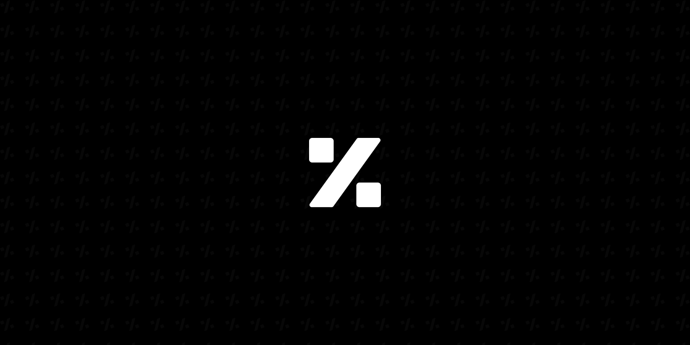

  

  <a href="https://github.com/PercentSA">English</a> · <b>العربية</b>

<h1 align="center">Percent</h1>

  <b>نصمّم ونبني برمجيات يستمتع الناس باستخدامها.</b> 
  استوديو برمجيات في السعودية

  
  

---

### خدماتنا

نصمّم. نبني. نشغّل. من أول رسم تخطيطي إلى نظام يعمل كل يوم. فريق واحد للمنتج كاملًا.

| **التصميم** | **البناء** | **التشغيل** |
| :-- | :-- | :-- |
| تصميم واجهات وتجربة المستخدم | تطبيقات ومنصات ويب | السحابة وDevOps والاستضافة |
| مواقع وصفحات هبوط | تطبيقات الجوال (iOS وAndroid) | التكاملات وواجهات API: المدفوعات والرسائل والخرائط |
| | أنظمة داخلية: ERP وCRM ولوحات تحكم | الصيانة والدعم |
| | متاجر إلكترونية | |

### كيف تعمل معنا

- **مشروع**: نطاق محدد، وسعر ثابت، وجدول زمني واضح خلال 10 أسابيع. عندما تعرف ما تحتاجه.
- **فريق مخصص**: اشتراك شهري. مصممو ومهندسو Percent يعملون على منتجك. للمنتجات التي تستمر في النمو.
- **الدعم والصيانة**: خطة شهرية للاستضافة والتحديثات والإصلاحات. لما بعد الإطلاق.

### التقنيات التي استخدمناها

  
  
  
  
  
  
  
  
  
  
  

---

  عندك مشروع؟ <a href="https://percent.sa/ar">أخبرنا بما تريد بناءه</a>. نرد خلال 12–24 ساعة.

